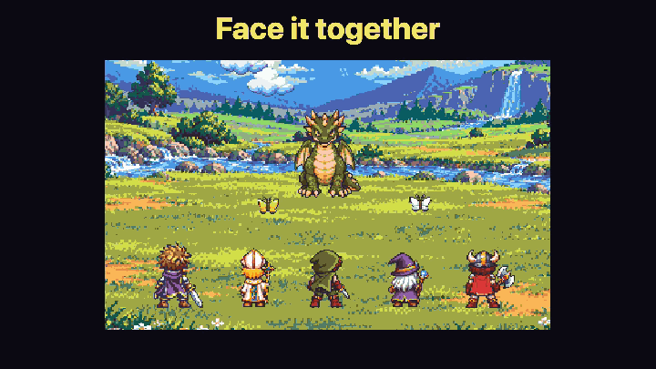

<p align="center">
  
</p>

<p align="center">
  <strong>退屈な仕事を冒険に。</strong><br/>
  AI コーディングエージェントが、ドット絵の RPG の町で勇者になる。
</p>

<p align="center">
  <a href="LICENSE"></a>
  
  
</p>

<p align="center"><a href="README.md">English</a></p>

---

> **Claude Code や pi はいつも通りに使うだけ。セッションごとに勇者が町へやってきて、仕事を戦いで片付け、報告を持って帰ってきます。**

Yushario は、コーディングエージェントの仕事を小さな RPG として見せるローカルのブラウザアプリです。セッションは勇者に、プロジェクトは町になります。編集・テスト・コマンドは戦闘に、サブエージェントは仲間に、終わった仕事は開けられる宝箱になって届きます。

<p align="center">
  
  <br/>
  <sub><em>プロジェクトごとに町ができます。村・港・雪・砂漠・火山の5種類。</em></sub>
</p>

<p align="center">
  
  <br/>
  <sub><em>サブエージェントに任せた仕事は、仲間が一緒に戦います。</em></sub>
</p>

## なぜ作ったか

AI エージェントの待ち時間を、眺めていて楽しいものにしたくて作りました。エージェントに身体を持たせ、勇者として町で動き回らせています。作業の効率化や、考えることを減らすためのツールではありません。

## 特徴

- **1セッションに1人の勇者**：エージェントを起動すると、そのプロジェクトの町に勇者がやってきます。
- **仕事は戦闘**：フィールドで今の作業が分かります。Lv・HP・MP は、終えた仕事・最近の失敗・残りのコンテキストを表します。
- **サブエージェントは仲間**：Explore は盗賊、Plan は僧侶、general-purpose は戦士、自分で定義したエージェントは魔法使いとして加わります。
- **はなす・報告**：依頼を送る、報告を読む、Claude Code の許可要求に答える。町から離れずにできます。
- **通知の音**：許可・報告・失敗・レベルアップだけ控えめに。上部のボタンで「ぜんいん／ついていく勇者だけ（許可は全員）／なし」を切り替えます。
- **やすむ・いのる**：手の空いた勇者は宿屋で居眠りし、会話の整理は教会で行います。
- **本物のターミナル付き**：いつでも同じ CLI セッションを開けます。Yushario はエージェントの代わりにはなりません。

## 対応エージェント

| エージェント | 勇者と町 | 埋め込みターミナル |
| --- | :---: | :---: |
| Claude Code | ✅ | ✅ |
| [pi](https://pi.dev/) | ✅ | ✅ |
| Codex 0.164.0 | ✅* | ✅ |
| shell | — | ✅ |

フックを付けるのは Yushario から起動したエージェントだけです。個人の設定ファイルは書き換えません。

*Codex：観察を有効にするには、自身のターミナルの `/hooks` で Yushario のフックを確かめて信頼します。クエストで新しく出陣する勇者には、依頼を CLI の初期プロンプトとして渡します。町・会話・クエスト・報告・パーティーへの配送・`resume`・`/compact` に対応。許可はターミナルで答えます。道具の終了通知には公式に定義された終了コードがないため、合格条件の自動証拠・編集成功の一覧・MP は取れません。合格条件は未実行のまま、合格を推測しません。フックの信頼確認と管理者の制限はそのままです。

Claude Code の auto モードでは、Claude が自分で許可するため、許可の窓はほとんど出ません。

## はじめ方（Quick Start）

1. macOS または Linux に Node.js 22.13 以上を用意します。
2. Claude Code・Codex・pi のいずれかをインストールし、ログインします。各 CLI の動作要件は別途満たしてください。Yushario は既存のログインを利用します。
3. 作業するプロジェクトのフォルダでターミナルを開き、実行します。

```sh
npx yushario@latest
```

リポジトリの clone やグローバルインストールは不要です。終了はターミナルで **Ctrl+C**。起動中のエージェントも終了します。

ブラウザで町が開きます。**しゅつじん**で行き先にプロジェクトのフォルダを選んでエージェントを起動し、勇者をクリックしてください。どのフォルダから起動しても構いません。起動したフォルダは行き先の最初の候補になります。

**クエストを書く → 勇者に任せる → 報告と変更を見る → 採用する（または やり直してもらう）。** 新しい勇者（Claude・Codex・pi）は依頼を CLI の初期プロンプトとして受け取ります。既存の勇者には「指示を送る」で渡します。起動・信頼の確認はターミナルで人が答えます。 町はプロジェクト、勇者は CLI のセッション、クエストは勇者が去った後も残る仕事です。クエストの札には いつも「次にやること」が出ます。報告を読み、鑑定で git の変更、合格条件で証拠を確かめて受け取ります。採用しない時は なおしてもらうと、勇者が もう一度 作業します。HP は最近の失敗の少なさ、MP は会話の残り、Lv は終えた仕事で、コードの品質の点数ではありません。Yushario から起動すればフックと pi 拡張は自動で付きます。

画面はブラウザの言語から日本語か英語を選びます。「せってい → 言語」で変更でき、選んだ言語は保存されます。

ソースからビルドして起動する場合：

```sh
git clone https://github.com/Morishita-mm/Yushario.git
cd Yushario
npm install && npm run build && npm start
```

ポートなどの設定は `npx yushario --help` で確認できます。

## プライバシーとセキュリティ

- `127.0.0.1` だけで動き、起動ごとのランダムなトークンで守ります。ターミナルは利用者の権限で動くので、**公開プロキシやトンネルで外に出さないでください。**
- クエストの題・状態・報告の要点は `~/.config/agent-character/yushario.db` に残ります。依頼と返事の本文は「かいわも のこす」を選んだ時だけ保存します（既定はオフ）。題（依頼の1行目）はいつも残ります。端末の出力はメモリだけ。町と設定は JSON のままです。クエストの記録は設定から消せます。

## 開発

```sh
npm install
npm run dev        # Vite とローカルサーバー
npm run typecheck
npm test
```

[構成](docs/ARCHITECTURE.md)、[プラットフォームの設計](docs/PLATFORM.md)、[絵の作り方](docs/ART.md)、[PV の道具](tools/demo/README.md)も見てください。

## ライセンスとクレジット

- コード：[MIT](LICENSE)。
- 絵とロゴは OpenAI の画像生成（ChatGPT・Codex）で作り、アプリ用に手を加えました。権利は主張しません。
- パレット：Kerrie Lake 作 [Resurrect 64](https://lospec.com/palette-list/resurrect-64)。フォント：[DotGothic16](https://github.com/fontworks-fonts/DotGothic16)（SIL OFL 1.1）。
- PV：ベートーヴェン『交響曲第9番』の旋律（パブリックドメイン）を使った自作の8bit曲。効果音は[効果音ラボ](https://soundeffect-lab.info/)で、このリポジトリには含めません。

Claude Code・Codex・pi は各権利者の製品で、Yushario は提携・推薦を受けていません。詳しくは [NOTICE](NOTICE) を見てください。
